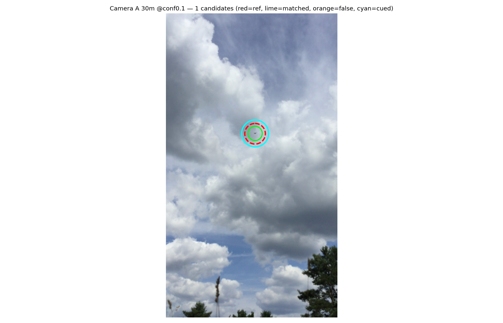

# Small Objects in Big Frames

**Public study artifacts · original evaluation outputs · one public rerun of the released model**

A drone about 40 pixels wide in a 1080 × 1920 phone frame shrinks to about 13 pixels when the whole frame is resized for a detector. This study ran the detector over overlapping full-resolution crops instead. In eight selected field frames, that scan surfaced a candidate next to the manually marked drone in every one. Choosing the right candidate among several is the open problem.

This repository holds the screened documentary account and the original evaluation images. The recovered checkpoint, sanitized notebooks and a rerunnable script are in the separate [Hugging Face release](https://huggingface.co/Seemorgh/yolo11n-aod4-v6). The original detector application stays private.

## Inspect the work

- [Portfolio account](https://mehridian.tech/projects/small-object-detection)
- [Technical reference](docs/technical-reference.md)
- [Recovered training report and recorded validation results](docs/training-report.md)
- [Retained observations and limits](docs/observations.md)
- [Visual provenance](docs/visuals.md)
- [Saved evaluation summary](docs/recorded-evaluation-summary.md) and [structured counts](docs/recorded-evaluation-counts.json): historical prediction-presence counters, not accuracy, recall or a measured false-positive rate. The executed companion is distinct from the public evaluation draft, and these counts don't reproduce the separate historical 7% → 22% table.

## What worked, and what's open

| Check | Unit | Result | Limit |
| --- | --- | --- | --- |
| Candidate next to the manual reference | 8 selected frames | Found in all 8 | The reference marks were used to check; not autonomous identification or general accuracy |
| Operator-cued selection, a separate check | 4 paired observations | 2 succeeded | Different task and denominator; not added to the frame count |
| Public rerun of the released `best.pt` | 1 public image, 2 passes | Boxed in both: bird 0.14 whole frame, airplane 0.42 tiled | One chosen image; neither pass says "drone"; not an accuracy result |
| Checkpoint identity | One recovered file | Digest matches a retained reference | Artifact identity, not training quality |

The eight-frame and two-of-four results are retained historical observations. The rerun is the only new model execution, made once on 27 October 2026 with the settings fixed beforehand. Its [script, receipt, environment list and input](https://huggingface.co/Seemorgh/yolo11n-aod4-v6/tree/8d8f622270dffef4a1529443b3ec781935fb4c7c/reproduce) are published next to the weights. The input is this repository's [`assets/capture-context.jpg`](assets/capture-context.jpg), byte for byte.

## Recovered training record

The retained Modal notebook records a 50-epoch run that reached **mAP50 0.96518** and **mAP50–95 0.66663** on **4,514 validation images**. On its own dataset, that's a well-trained detector. The scores are averaged across airplane, bird, drone and helicopter on the validation split, so they aren't drone-only accuracy, a held-out test result or field reliability.

All 200 stored metric-history values in the recovered checkpoint agree with the notebook's 50 training epochs within printed rounding precision. That strongly supports the same-run origin; an original byte-for-byte transfer receipt wasn't found. The [sanitized training report](docs/training-report.md) keeps the checkpoint's stored metrics separate from the notebook's slightly different later validation scores, and documents the dataset's CC BY 4.0 declaration and the checkpoint's AGPL-3.0 notice.

## Public model and reviewed notebooks

Published 22 October 2026 on [Hugging Face](https://huggingface.co/Seemorgh/yolo11n-aod4-v6):

- [Recovered YOLO11n checkpoint and model card](https://huggingface.co/Seemorgh/yolo11n-aod4-v6); [release files](https://huggingface.co/Seemorgh/yolo11n-aod4-v6/tree/692377dc55f682cbe5fe17fc5944514574ca9b08).
- [Sanitized training and Core ML export notebook](https://huggingface.co/Seemorgh/yolo11n-aod4-v6/blob/692377dc55f682cbe5fe17fc5944514574ca9b08/notebooks/01_train_export.ipynb): edited code with a labelled historical-results summary; original raw outputs and the credential literal are excluded.
- [Exploratory evaluation notebook](https://huggingface.co/Seemorgh/yolo11n-aod4-v6/blob/692377dc55f682cbe5fe17fc5944514574ca9b08/notebooks/02_eval_tiling_range.ipynb): an **unexecuted draft in the retained record**, with unsupported validation claims corrected.
- [Notebook review and sanitization notes](https://huggingface.co/Seemorgh/yolo11n-aod4-v6/blob/692377dc55f682cbe5fe17fc5944514574ca9b08/NOTEBOOK_REVIEW.md), including method limitations and publication edits.

Added 27 October 2026: [`reproduce/`](https://huggingface.co/Seemorgh/yolo11n-aod4-v6/tree/8d8f622270dffef4a1529443b3ec781935fb4c7c/reproduce), the one-run script and receipt described above.

The notebook links pin the reviewed release revision. Publication-file checksums identify the released bytes; they don't supply the missing original cloud-to-local transfer receipt or independently authenticate the old training run. No new training, inference, conversion or evaluation was performed for that publication. Exact checkpoint-to-Core-ML equivalence and successful device inference remain unverified.

The evaluation draft implements two exploratory steps despite its original three-step title. It counts aerial predictions without matching boxes to ground truth, and bird predictions are class counts, not measured false positives. Increased prediction frequency doesn't validate tiling, recall, a detection floor or physical range. Neither notebook establishes field reliability or on-device performance.

The model release keeps the checkpoint's AGPL-3.0 designation; the dataset's CC BY 4.0 attribution is separate. The links don't establish an Enterprise agreement, Apache-2.0 relicensing permission or redistribution compliance.

## Original evaluation outputs

Output A shows a candidate beside the manual reference. The marks are unchanged, and the match was checked against the manual reference; it isn't autonomous target identification. [Output B](assets/retained-output-b.png) shows the competing candidates over sky and trees, in its original sideways orientation. That's the selection problem, kept as it was recorded.

## Access boundary

The original application implementation, raw media archive, datasets, geometry and operational components remain private. The recovered weights, edited notebooks and the rerun script are in the separate Hugging Face release, not in this repository. There's no application install command, inference endpoint, containerized detector or live camera feed. A screenshot or recorded walkthrough of these artifacts must be labelled as historical material; only the `reproduce/` run is a fresh one.

The owner approved these screened visuals and documentary findings for public use on 22 October 2026. Private source registers and evidence coordinates are excluded. This documentation repository grants no new open-source licence for the original application or model.

See [SHA256SUMS.txt](SHA256SUMS.txt) for included-file integrity. Hashes establish file identity, not the truth of historical claims.
